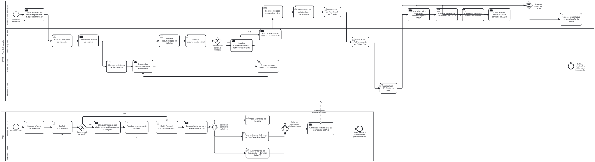

# Exportar BPMN para SVG no Windows

Este conjunto adiciona uma rotina local para gerar `processo.svg` a partir de
`processo.bpmn`, sem alterar o modelo BPMN e sem usar um serviço online.

## Onde colocar

Copie os quatro arquivos auxiliares (`package.json`, `exportar-svg.cmd`,
`.gitignore` e `LEIA-ME.md`) para:

`processos/contratacao-bolsista/`

A pasta deverá ficar assim:

```text
contratacao-bolsista/
├── processo.bpmn
├── processo.md
├── processo.svg          (será criado/atualizado pela rotina)
├── package.json
├── exportar-svg.cmd
├── .gitignore
└── LEIA-ME.md
```

Não substitua `processo.bpmn` nem `processo.md`. Este pacote contém somente
os arquivos auxiliares da exportação.

## Pré-requisito

Instale o Node.js LTS para Windows, caso ainda não esteja instalado:

https://nodejs.org/

Depois da instalação, feche e abra novamente o VS Code.

Para conferir, abra o terminal integrado do VS Code (`Terminal > New Terminal`)
e execute:

```powershell
node --version
npm --version
```

Os dois comandos devem mostrar números de versão.

## Primeira execução

1. Abra `processos/contratacao-bolsista` no Explorador de Arquivos.
2. Dê dois cliques em `exportar-svg.cmd`.

   Alternativamente, no terminal do VS Code, estando nessa pasta, execute:

```powershell
.\exportar-svg.cmd
```

Na primeira execução, o script instala `bpmn-to-image` e suas dependências
com `npm install`. É necessário ter conexão com a internet. A instalação
pode demorar porque o mecanismo de renderização utiliza Puppeteer/Chromium.

## Próximas execuções

Depois da instalação inicial, basta salvar as alterações em `processo.bpmn`
e executar novamente `exportar-svg.cmd`.

O arquivo `processo.svg` será atualizado na mesma pasta.

## Atualizar a documentação

Mantenha no `processo.md` a referência relativa:

```markdown

```

Abra a pré-visualização Markdown no VS Code (`Ctrl+Shift+V`). Se ela já
estiver aberta, atualize ou reabra a pré-visualização para recarregar a imagem.

## Observações

- `processo.bpmn` continua sendo a fonte editável; o SVG é uma imagem derivada.
- A rotina não modifica o BPMN.
- A primeira instalação exige internet; depois, a exportação é local.
- `node_modules/` é gerada automaticamente e não precisa ser compartilhada.
- A ferramenta `bpmn-to-image` renderiza o BPMN com `bpmn-js` e exporta SVG
  utilizando Puppeteer.
